  

  

  

  
  
  
  

### 🔐 Also open source

**[kyber-rs](https://github.com/teleconsys/kyber-rs)**: distributed key generation and threshold signatures for Rust.

### 🛠️ Toolbox

### 💖 Support

My open source work happens in my own time. If it helps you, a sponsorship keeps it going.

  
  

